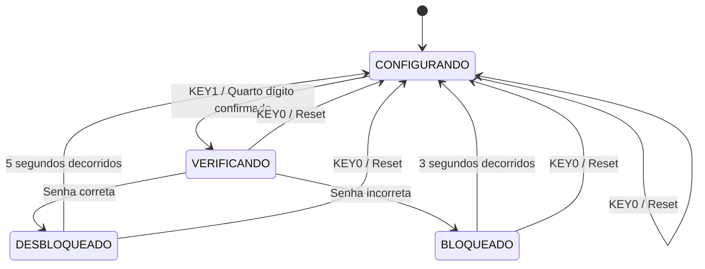

# Projeto-SD-SafeCrackPro
## Descrição detalhada de como os requisitos foram implementados
1. Organização do projeto

O projeto é dividido em três módulos SystemVerilog:

Módulo	Papel
safecrackpro_top	Módulo de topo: liga a FSM e os decodificadores aos pinos da DE2-115 (clock, KEYs, HEX0 a HEX4, LEDs).
safecrackpro_fsm	Toda a lógica do cofre: edição dos dígitos, detecção de borda, verificação da senha, temporização e LEDs.
bcd_to_7segment_anodo	Decodificador combinacional de um dígito (0 a 9) para os 7 segmentos.

O safecrackpro_top instancia uma FSM (fsm_inst) e cinco decodificadores: quatro para os dígitos da senha (HEX3 a HEX0) e um para o indicador de posição (HEX4).

2. A máquina de estados

A FSM usa quatro estados, definidos em um enum logic [1:0]:

Estado	Função
CONFIGURANDO	usuário edita e confirma os dígitos
VERIFICANDO	estado de passagem (um ciclo de clock) que compara a senha digitada com SENHA
DESBLOQUEADO	senha correta: LEDs verdes acesos por 5 s
BLOQUEADO	senha incorreta: LEDs vermelhos acesos por 3 s

Os registradores do projeto são:

state e next_state: estado atual e próximo estado;
digits (logic [3:0][3:0]): os quatro dígitos, 4 bits cada;
current_position_idx (2 bits): dígito ativo, de 0 a 3;
btn_prev e btn_edge: histórico e pulsos de borda dos botões;
timer_count (32 bits): contador de ciclos para a sinalização dos LEDs.

O desenho segue a separação clássica: blocos always_ff guardam os registradores, e blocos always_comb calculam o próximo estado, a comparação da senha e as saídas.

3. Como cada requisito foi implementado
3.1 Senha de quatro dígitos (0 a 9) exibidos em HEX3 a HEX0

digits é um array empacotado de 4 posições × 4 bits, inicializado em zero (= '0). A correspondência com os displays é feita no safecrackpro_top:

systemverilog
bcd_to_7segment_anodo dec_hex3 (.bcd(digits[0]), .seg(HEX3));  // 1º dígito
bcd_to_7segment_anodo dec_hex2 (.bcd(digits[1]), .seg(HEX2));  // 2º dígito
bcd_to_7segment_anodo dec_hex1 (.bcd(digits[2]), .seg(HEX1));  // 3º dígito
bcd_to_7segment_anodo dec_hex0 (.bcd(digits[3]), .seg(HEX0));  // 4º dígito

A senha correta é uma constante localparam:

systemverilog
localparam logic [3:0][3:0] SENHA = {4'd4, 4'd3, 4'd2, 4'd1};

Em uma concatenação o primeiro elemento é o mais significativo, então SENHA[0]=1 e SENHA[3]=4, ou seja, a senha na ordem de digitação é 1-2-3-4.

O decodificador bcd_to_7segment_anodo usa um case com a máscara de cada algarismo. Como os displays da DE2-115 são de ânodo comum, os segmentos são ativos em nível baixo (por exemplo, 4'd0: seg = 7'b1000000, em que só o segmento central fica apagado). Para valores fora de 0 a 9, o default apaga o display (7'b1111111).

3.2 Dígito ativo exibido em HEX4

Internamente a posição vai de 0 a 3, mas para o usuário ela é mostrada de 1 a 4:

systemverilog
bcd_to_7segment_anodo dec_hex4 (
    .bcd({2'b00, current_position_idx} + 4'd1),
    .seg(HEX4)
);

A concatenação estende o índice para 4 bits e o + 4'd1 converte a posição interna na posição exibida.

3.3 Estado inicial e reset (KEY[0])

Existem duas camadas:

Valores iniciais de declaração (digits = '0, current_position_idx = '0, state = CONFIGURANDO, btn_prev = 3'b111, timer_count = '0), que definem o estado da FPGA logo após a configuração.
Reset assíncrono pelo KEY[0]: todos os blocos always_ff têm negedge btn[0] na lista de sensibilidade e tratam !btn[0] primeiro.

O efeito do reset em cada bloco é:

dígitos e posição: digits <= '0 e current_position_idx <= '0;
FSM: state <= CONFIGURANDO;
histórico de botões: btn_prev <= 3'b111 (tudo solto);
temporizador: timer_count <= '0.

Os LEDs não precisam de tratamento próprio: dependem só de state, então ao voltar para CONFIGURANDO ficam apagados. Como o reset é assíncrono, vale em qualquer estado, inclusive durante a sinalização dos LEDs.

3.4 Incremento e decremento com wrap-around (KEY[2] e KEY[3])

Os botões são identificados por constantes (BTN_CONFIRMAR = 1, BTN_INCREMENTAR = 2, BTN_DECREMENTAR = 3). No bloco always_ff dos dígitos, só o dígito apontado por current_position_idx é escrito, e apenas quando state == CONFIGURANDO:

systemverilog
if (state == CONFIGURANDO && btn_edge[BTN_INCREMENTAR]) begin
    if (digits[current_position_idx] == 4'd9) digits[current_position_idx] <= 4'd0;
    else digits[current_position_idx] <= digits[current_position_idx] + 4'd1;
end
else if (state == CONFIGURANDO && btn_edge[BTN_DECREMENTAR]) begin
    if (digits[current_position_idx] == 4'd0) digits[current_position_idx] <= 4'd9;
    else digits[current_position_idx] <= digits[current_position_idx] - 4'd1;
end
KEY[2]: soma 1, e de 9 volta para 0.
KEY[3]: subtrai 1, e de 0 vai para 9.

Os testes explícitos com 9 e 0 implementam o wrap-around e garantem que o dígito nunca assuma valores de 10 a 15. Como a atribuição é indexada, os demais dígitos não são alterados.

3.5 Confirmação e avanço (KEY[1])
systemverilog
else if (state == CONFIGURANDO && btn_edge[BTN_CONFIRMAR]) begin
    if (current_position_idx != 2'd3)
        current_position_idx <= current_position_idx + 2'd1;
end

O valor do dígito atual fica fixado porque nada mais o escreve depois que o índice avança. A condição != 2'd3 impede o índice de passar da última posição. Não há nenhuma atribuição que diminua current_position_idx, então a navegação é estritamente para frente. Só o reset (ou o fim do ciclo de LEDs) leva de volta ao primeiro dígito.

3.6 Verificação da senha ao confirmar o quarto dígito

A verificação envolve três partes:

Comparação contínua (combinacional), que mantém senha_correta sempre atualizado:
systemverilog
always_comb senha_correta = (digits == SENHA);

Como digits e SENHA são vetores de 16 bits, um único == compara os quatro dígitos simultaneamente.

Saída de CONFIGURANDO: a lógica de próximo estado vai para VERIFICANDO quando ocorre btn_edge[BTN_CONFIRMAR] com current_position_idx == 2'd3.
Decisão em VERIFICANDO:
systemverilog
else if (state == VERIFICANDO) begin
    if (senha_correta) next_state = DESBLOQUEADO;
    else               next_state = BLOQUEADO;
end

VERIFICANDO dura um ciclo de clock e separa o instante da confirmação do instante da decisão, o que deixa a transição fácil de acompanhar nas formas de onda.

3.7 Sinalização por LEDs e retorno automático ao início

Os LEDs são função direta do estado:

systemverilog
led_green = (state == DESBLOQUEADO) ? '1 : '0;   // 9 LEDs verdes
led_red   = (state == BLOQUEADO)    ? '1 : '0;   // 18 LEDs vermelhos

O tempo é controlado por timer_count, que usa constantes baseadas no clock de 50 MHz:

systemverilog
localparam logic [31:0] TEMPO_DESBLOQUEADO = 32'd250000000;  // 5 s
localparam logic [31:0] TEMPO_BLOQUEADO     = 32'd150000000;  // 3 s

O comportamento do contador é:

Em DESBLOQUEADO ou BLOQUEADO, incrementa a cada clock.
Ao atingir o tempo do estado, é zerado.
Nos demais estados, permanece em zero. Assim, a contagem sempre começa do zero quando a FSM entra em um dos estados de resultado.

Quando timer_count >= TEMPO_..., ocorrem duas coisas ao mesmo tempo:

a lógica de próximo estado leva a FSM de volta a CONFIGURANDO;
o bloco dos dígitos zera digits e current_position_idx.

Com isso, na volta à digitação os displays mostram 0000 e o dígito ativo é o primeiro, como pede o enunciado.

3.8 Uma ação por pressionamento (detecção de borda)

Os botões são ativos em nível baixo (solto = 1, pressionado = 0). A detecção de borda usa um registrador de histórico e uma expressão combinacional:

systemverilog
// histórico, atualizado a cada clock
btn_prev <= btn[3:1];

// borda de pressionamento (1 -> 0)
btn_edge = ~btn[3:1] & btn_prev;
~btn[3:1] vale 1 quando o botão está pressionado agora.
btn_prev vale 1 quando o botão estava solto no ciclo anterior.

Logo, btn_edge fica em 1 apenas no ciclo da transição solto→pressionado. Com o botão mantido, btn_prev passa a 0 e o pulso desaparece, de modo que cada clique gera uma única ação (um incremento, um decremento ou uma confirmação). O valor inicial 3'b111 de btn_prev, e o fato de o reset também o forçar a 111, evitam um pulso falso logo após energizar ou resetar.

4. Tabela de transições
Estado atual	Condição	Próximo estado	Efeito
CONFIGURANDO	borda de KEY[2]	CONFIGURANDO	dígito ativo +1 (9 → 0)
CONFIGURANDO	borda de KEY[3]	CONFIGURANDO	dígito ativo −1 (0 → 9)
CONFIGURANDO	borda de KEY[1], posição < 3	CONFIGURANDO	posição + 1
CONFIGURANDO	borda de KEY[1], posição = 3	VERIFICANDO	encerra a entrada
VERIFICANDO	senha_correta = 1	DESBLOQUEADO	LEDs verdes ligam
VERIFICANDO	senha_correta = 0	BLOQUEADO	LEDs vermelhos ligam
DESBLOQUEADO	timer_count >= 5 s	CONFIGURANDO	zera dígitos, posição e contador
BLOQUEADO	timer_count >= 3 s	CONFIGURANDO	zera dígitos, posição e contador
qualquer	KEY[0] pressionado	CONFIGURANDO	zera tudo (assíncrono)
5. Observações de projeto
Prioridade entre botões na edição: no bloco dos dígitos, o if / else if dá prioridade a incremento, depois decremento e depois confirmação.
Botões ignorados fora da digitação: todas as ações de edição exigem state == CONFIGURANDO. Durante VERIFICANDO, DESBLOQUEADO e BLOQUEADO os botões KEY[1] a KEY[3] não têm efeito. Só o reset interrompe a sinalização.
Duração dos LEDs: o estado dura TEMPO + 1 ciclos de clock (a contagem vai de 0 até TEMPO), diferença desprezível frente a 5 s ou 3 s.
Caso limite de dois botões no mesmo ciclo: se KEY[1] (no quarto dígito) e KEY[2] ou KEY[3] fossem pressionados exatamente no mesmo ciclo de clock, o dígito seria alterado e a FSM também iria para VERIFICANDO, pois a lógica de próximo estado não tem a mesma prioridade do bloco dos dígitos. É praticamente impossível com botões humanos, mas vale registrar.
Sincronização e debounce: as entradas dos botões vão direto para a lógica, sem sincronizador de dois flip-flops nem filtro de ruído. Na simulação isso não aparece. Na placa, o ruído mecânico pode gerar pulsos extras, e o KEY[0] como reset assíncrono sem sincronização também é uma escolha a justificar no relatório.
Tempos fixos no código: TEMPO_DESBLOQUEADO e TEMPO_BLOQUEADO assumem o clock de 50 MHz. Para simular rápido no ModelSim, normalmente se reduzem esses valores (ou se usa force no timer_count, no testbench).
## Diagrama de Estados

## Diagramas de tempo da simulação (waveforms)

## Descrição de possíveis bugs conhecidos (known issues)
