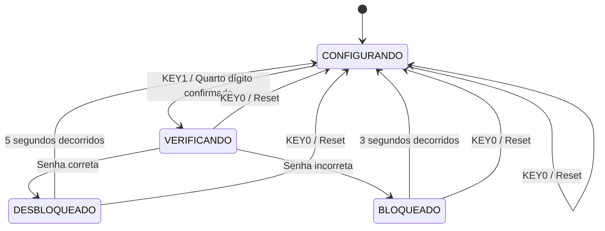

# Projeto-SD-SafeCrackPro
## Descrição detalhada de como os requisitos foram implementados
O SafeCrack Pro foi desenvolvido em SystemVerilog para a placa DE2-115, utilizando uma máquina de estados finitos (FSM) responsável por controlar a entrada da senha, sua verificação e a sinalização do resultado.

Organização dos módulos

O projeto foi organizado em três módulos, cada um com uma responsabilidade específica:

- safecrackpro_fsm: responsável pelo controle da lógica do cofre, incluindo a entrada dos dígitos, a verificação da senha, a temporização e o acionamento dos LEDs.
- bcd_to_7segment_anodo: responsável por converter os valores numéricos de 0 a 9 em sinais correspondentes aos segmentos dos displays de sete segmentos.
- safecrackpro_top: módulo principal, responsável por conectar a máquina de estados aos decodificadores e aos componentes físicos da placa.

Entrada da senha

O sistema permite a inserção de uma senha composta por quatro dígitos, cada um variando de 0 a 9. A entrada é realizada por meio dos botões da placa DE2-115:

- KEY3: decrementa o dígito selecionado.
- KEY2: incrementa o dígito selecionado.
- KEY1: confirma o dígito atual e avança para a próxima posição.
- KEY0: reinicia o sistema, retornando à primeira posição e zerando todos os dígitos.

Os valores são armazenados em um vetor de quatro posições, utilizando 4 bits para cada dígito. Ao atingir 9, um incremento retorna o valor para 0. Da mesma forma, ao atingir 0, um decremento retorna o valor para 9.

Para evitar que uma ação seja repetida enquanto o botão permanece pressionado, foi implementado um mecanismo de detecção de borda, que identifica o momento do pressionamento dos botões.

Exibição nos displays

Os quatro dígitos inseridos são apresentados simultaneamente nos displays de sete segmentos HEX3, HEX2, HEX1 e HEX0, respectivamente.

O display HEX4 indica a posição atualmente selecionada, exibindo valores de 1 a 4.

Para realizar a conversão dos valores numéricos em sinais para os segmentos dos displays, foi desenvolvido o módulo "bcd_to_7segment_anodo". Como os displays da DE2-115 possuem ânodo comum, os segmentos são acionados em nível baixo.

Verificação da senha

Após a confirmação do quarto dígito, o sistema passa para o estado de verificação, no qual os valores inseridos são comparados com a senha cadastrada no código, definida como 1234.

Caso os valores correspondam, a máquina de estados avança para o estado "DESBLOQUEADO". Caso contrário, avança para o estado "BLOQUEADO".

Máquina de estados

O controle do funcionamento do cofre é realizado por uma máquina de estados finitos composta por quatro estados:

- CONFIGURANDO: permite inserir, incrementar, decrementar e confirmar os dígitos da senha.
- VERIFICANDO: realiza a comparação entre a senha inserida e a senha cadastrada.
- DESBLOQUEADO: indica que a senha está correta.
- BLOQUEADO: indica que a senha está incorreta.

Após a sinalização do resultado, a máquina retorna automaticamente ao estado "CONFIGURANDO", permitindo uma nova tentativa.

Sinalização por LEDs e temporização

Quando a senha está correta, todos os LEDs verdes são acesos durante 5 segundos. Quando a senha está incorreta, todos os LEDs vermelhos são acesos durante 3 segundos.

A temporização é realizada por meio de um contador de ciclos de clock, considerando a frequência de 50 MHz da placa DE2-115. Assim, são utilizados 250.000.000 ciclos para os 5 segundos e 150.000.000 ciclos para os 3 segundos.

Ao término de cada intervalo, os LEDs são apagados, os dígitos são zerados e a posição selecionada retorna à primeira.

Reinicialização do sistema

O botão KEY0 realiza a reinicialização assíncrona do sistema, independentemente do estado atual da máquina. Ao ser pressionado, os dígitos são zerados, a posição retorna ao início, o temporizador é reiniciado, os LEDs são apagados e a FSM retorna ao estado "CONFIGURANDO".

Clock e mapeamento dos componentes

O funcionamento do sistema utiliza o clock de 50 MHz da placa DE2-115, conectado à entrada "clk" do módulo principal. Essa frequência também é utilizada como referência para a contagem dos intervalos de sinalização.

Os componentes físicos da placa, incluindo os quatro botões, os cinco displays de sete segmentos e os LEDs vermelhos e verdes, são associados aos respectivos sinais do código por meio do mapeamento dos pinos da FPGA, utilizando as atribuições de localização (Location Assignments) configuradas no projeto Quartus.
## Diagrama de Estados

## Diagramas de tempo da simulação (waveforms)

## Descrição de possíveis bugs conhecidos (known issues)
### Bounces: 
pode ocorrer uma oscilação mecânica rápida dos botões de incremento,
decremento, confirmar e reset na fpga o que pode causar na prática
mais de um "clique" no botão da placa. Isso ocorre devido a própria
estrutura elastica e metálica dos botões da placa, pode acontecer dos
contatos metalicos que ficam abaixo dos botões quicarem várias vezes devido a pressões no contato dos botões.
Isso ao final gera varias ações com apenas um unico clique.
